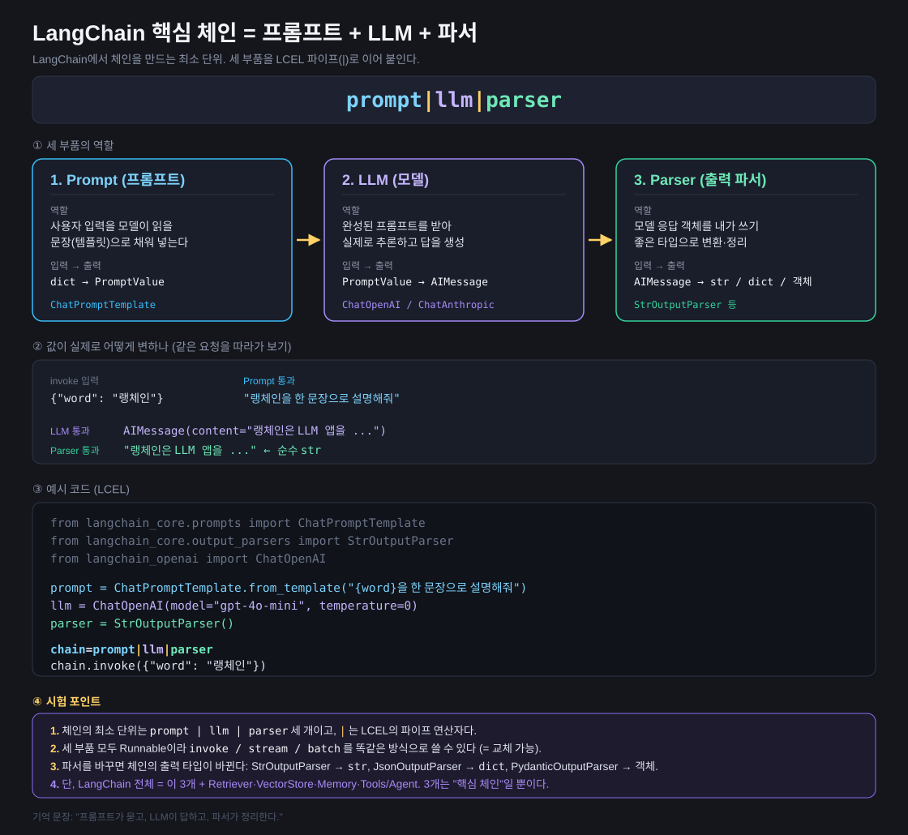

# 01. 핵심 체인 — prompt | llm | parser

> 기억 문장: **"프롬프트가 묻고, LLM이 답하고, 파서가 정리한다."**



## 세 부품의 역할

| 부품 | 역할 | 입력 → 출력 | 대표 클래스 |
|---|---|---|---|
| **Prompt** | 사용자 입력을 모델이 읽을 문장(템플릿)으로 채워 넣는다 | `dict` → `PromptValue` | `ChatPromptTemplate` |
| **LLM** | 완성된 프롬프트를 받아 실제로 추론하고 답을 생성 | `PromptValue` → `AIMessage` | `ChatOpenAI`, `ChatAnthropic` |
| **Parser** | 모델 응답 객체를 쓰기 좋은 타입으로 변환·정리 | `AIMessage` → `str` / `dict` / 객체 | `StrOutputParser` 등 |

## 값이 실제로 변하는 과정

```
{"word": "랭체인"}
      ↓ Prompt
"랭체인을 한 문장으로 설명해줘"
      ↓ LLM
AIMessage(content="랭체인은 LLM 앱을 ...")
      ↓ Parser
"랭체인은 LLM 앱을 ..."   ← 순수 str
```

## 실습 코드

[`core_chain.py`](core_chain.py)

```python
chain = prompt | llm | parser
chain.invoke({"word": "랭체인"})
```

## 시험 포인트

1. 체인의 최소 단위는 `prompt | llm | parser` 세 개이고, `|` 는 **LCEL의 파이프 연산자**다.
2. 세 부품 모두 **Runnable**이라 `invoke` / `stream` / `batch` 를 똑같은 방식으로 쓸 수 있다(= 서로 교체 가능).
3. **파서를 바꾸면 체인의 출력 타입이 바뀐다**: `StrOutputParser` → `str`, `JsonOutputParser` → `dict`, `PydanticOutputParser` → 객체.
4. 단, LangChain 전체 = 이 3개 + Retriever·VectorStore·Memory·Tools/Agent. **3개는 "핵심 체인"일 뿐이다.**
