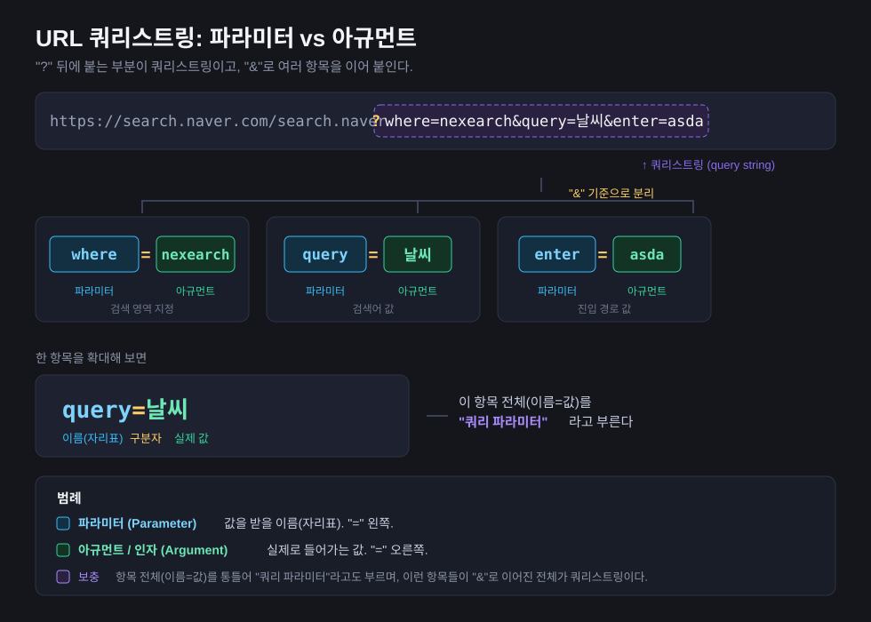

# URL 쿼리스트링 — 파라미터 vs 아규먼트



예시 URL:

```
https://search.naver.com/search.naver?where=nexearch&query=날씨&enter=asda
```

- `?` 뒤가 **쿼리스트링**, 항목들은 `&` 로 이어진다
- `=` **왼쪽** = **파라미터(Parameter)** — 값을 받을 이름(자리표)
- `=` **오른쪽** = **아규먼트/인자(Argument)** — 실제로 들어가는 값
- 항목 전체(`이름=값`)를 통틀어 **쿼리 파라미터**라고도 부른다

| 항목 | 파라미터 | 아규먼트 | 의미 |
|---|---|---|---|
| `where=nexearch` | `where` | `nexearch` | 검색 영역 지정 |
| `query=날씨` | `query` | `날씨` | 검색어 값 |
| `enter=asda` | `enter` | `asda` | 진입 경로 값 |

> 참고: 실제 전송 시 `날씨` 는 `%EB%82%A0%EC%8B%A8` 로 퍼센트 인코딩된다. 다이어그램은 가독성을 위해 원문으로 표기했다.
